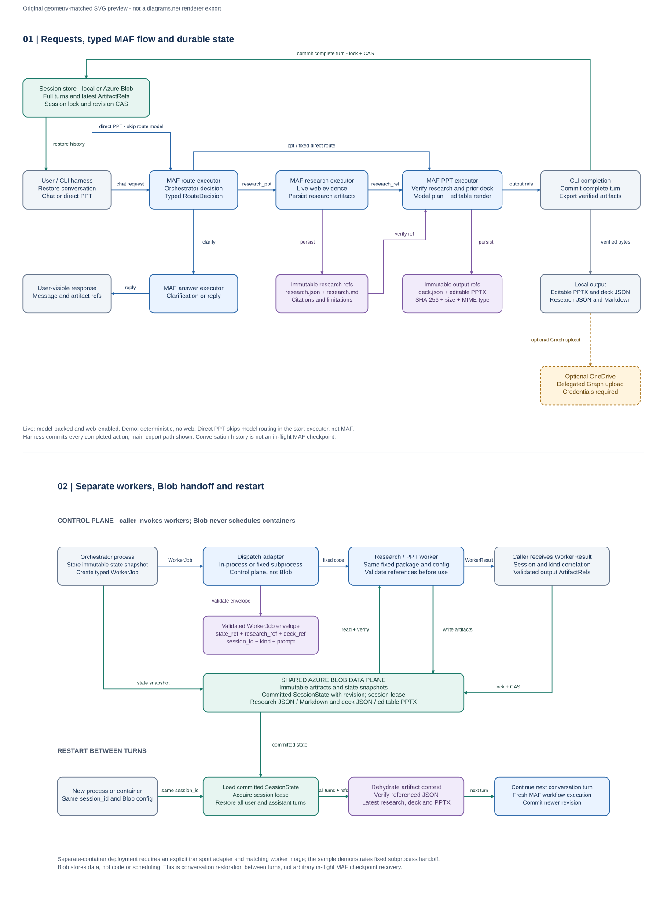

# Durable research and Contoso presentation workflow

A runnable **Microsoft Agent Framework (MAF) Python workflow** with an orchestrator,
a web researcher, and a PowerPoint agent. A small CLI and a local HTTP API are
the user/backend harnesses; there is deliberately no UI.

This is a **teaching sample, not a production service**. Live mode calls a model
deployed in Microsoft Foundry; demo mode remains available for offline learning.
Read the request, routing, worker and persistence steps in order before refactoring.
The sample intentionally keeps related logic together instead of introducing a
settings framework, service layer or a separate conversation engine.

Two entry paths share the same typed MAF graph:

| Use case | Path | Result |
| --- | --- | --- |
| Direct presentation | User request -> PPT executor, bypassing model routing | Editable Contoso-themed `.pptx`, deck JSON, local file paths |
| Orchestrated conversation | Orchestrator -> research, PPT, research + PPT, or clarification | Research JSON/Markdown and/or PPT, with durable conversation history |

The orchestrator knows each worker's capabilities. Workers communicate through
**immutable artifact references**, not container-local paths. Local disk works for
development; Azure Blob Storage provides the shared data plane for separate
containers. The CLI restores the entire committed conversation when `--session`
is reused, including per-turn artifact references and the latest research/deck.



The editable diagram is [diagrams/workflow.drawio](diagrams/workflow.drawio).
See [the architecture and design critique](docs/architecture.md) for the
cross-container boundary, adopted hosted-agent patterns, and production gaps.

## Quick start: no model or cloud credentials needed

Use Python 3.11 or later. The sample pins `agent-framework-core==1.21.0` and the
independently versioned `agent-framework-openai==1.14.4` because workflow and
agent APIs evolve; it does not emulate MAF.

PowerShell:

```powershell
python -m venv .venv
.\.venv\Scripts\python.exe -m pip install --upgrade pip
.\.venv\Scripts\python.exe -m pip install --prefer-binary -e ".[dev]"

# Use case 1: supplied content directly to the PPT agent.
.\.venv\Scripts\python.exe -m contoso_agents invoke --agent-mode demo --direct-ppt `
  --prompt "Create a Contoso PPT about Azure networking. Include private endpoints and DNS."
```

The JSON response contains `session_id`, `action`, `revision`, immutable artifact
references, storage locations, and **absolute `local_path` values for generated
files**. The actual PowerPoint file is exported under `output`; the response is
not a claim that a file was generated without providing it.

`demo` is an **offline deterministic harness**: no model calls, no web access,
and no fabricated web evidence. It exercises the real MAF graph and actual PPT
generation. Use `live` for natural-language routing and web-backed research.
The CLI and HTTP API load `.env` from the **current working directory**.
Existing process environment variables take precedence. Run commands from the
repository root; `.env` is ignored by Git and `.env.example` is the shareable template.

### Calling the workflow from a Python backend

The CLI and HTTP API are thin adapters over the same callable a Python backend can use:

```python
import asyncio
from uuid import uuid4

from contoso_agents.agents import create_agents
from contoso_agents.storage import create_store
from contoso_agents.workers import InProcessDispatcher
from contoso_agents.workflow import invoke

async def main():
    store = create_store()
    agents = create_agents("demo")  # "live" requires configured model credentials
    dispatcher = InProcessDispatcher(store, agents)
    session_id = str(uuid4())      # Return this to the caller; reuse it for later turns
    result = await invoke(
        store, agents, dispatcher, session_id,
        "Research Azure networking and create a Contoso PPT.",
    )
    print(result.model_dump_json(indent=2))
    # Artifact bytes are fetched with store.read_artifact(ref), not a worker-local path.

asyncio.run(main())
```

A backend must authorize session access and stream or export the verified
artifact bytes to its caller; an Azure Blob URI alone is not a public download
link. The CLI already performs local export and reports the resulting paths.

### Use case 2: research, create, then revise after a restart

```powershell
$first = .\.venv\Scripts\python.exe -m contoso_agents invoke --agent-mode demo `
  --worker-mode process `
  --prompt "Research Azure networking and create a Contoso PPT." | ConvertFrom-Json
$session = $first.session_id
$first.files | Select-Object local_path

# Each command is a NEW process. No prior in-memory agent is required.
.\.venv\Scripts\python.exe -m contoso_agents invoke --agent-mode demo `
  --worker-mode process --session $session --prompt "Add a slide about cost controls"
.\.venv\Scripts\python.exe -m contoso_agents invoke --agent-mode demo `
  --session $session --prompt "Remove cost controls"
.\.venv\Scripts\python.exe -m contoso_agents invoke --agent-mode demo `
  --session $session --prompt "Re-create the PPT"
.\.venv\Scripts\python.exe -m contoso_agents invoke --agent-mode demo `
  --session $session --prompt "What did we discuss?"

# Inspect all committed turns, or retrieve a generated artifact later.
.\.venv\Scripts\python.exe -m contoso_agents show-session --session $session
.\.venv\Scripts\python.exe -m contoso_agents export --session $session --kind ppt
.\.venv\Scripts\python.exe -m contoso_agents export --session $session --kind research
```

The demo supports this intentionally small vocabulary; it is not a substitute
for a language model. A clarification produces an answer without regenerating a
PPT. Revisions read the saved editable deck specification, generate a new PPT
artifact, and preserve older versions rather than overwriting them.

## Live Foundry model calls with local Azure login

Copy the template, then edit the two Foundry connection values in `.env`:

```powershell
if (!(Test-Path .env)) { Copy-Item .env.example .env }
# Edit .env before proceeding.
az login
.\.venv\Scripts\python.exe -m contoso_agents invoke --agent-mode live `
  --prompt "Research Azure Private Link using Microsoft Learn and create a Contoso PPT for architects."
```

```dotenv
CONTOSO_AGENT_MODE=live
AZURE_AI_FOUNDRY_ENDPOINT=https://<resource>.services.ai.azure.com/openai/v1/
AZURE_AI_MODEL_DEPLOYMENT_NAME=<your-deployment-name>
```

Use the deployment's **OpenAI-compatible v1 endpoint**, not a Foundry project
URL ending in `/api/projects/...`. The model must support chat completions,
tool/function calls and structured JSON outputs. The deployment name is not
necessarily the catalog model name. Foundry resources can also expose the v1
endpoint under `https://<resource>.openai.azure.com/openai/v1/`; use the endpoint
shown for your deployment rather than guessing it.

Foundry calls use `AzureCliCredential`, so **you perform `az login` locally**.
The sample requests a token for `https://ai.azure.com/.default`;
no API key or copied bearer token belongs in `.env`. Your signed-in identity
needs model-inference access to the existing resource (for example the
appropriate Cognitive Services OpenAI User role) and network access to it.
This sample does not create a deployment or grant access.

For a live test, have the endpoint, deployment name and completed Azure CLI
login ready. Authentication, unsupported model features and model/network errors
fail explicitly; live mode never silently switches to demo.

The previous `OPENAI_API_KEY`/`OPENAI_MODEL` and
`AZURE_OPENAI_ENDPOINT`/`AZURE_OPENAI_CHAT_DEPLOYMENT_NAME` configurations remain
available for comparison. Foundry settings select the Foundry connection.
See `src/contoso_agents/agents/__init__.py` for the client construction.
Never commit keys, tokens or `.env`.

The live orchestrator, researcher and PPT planner are separate MAF model agents.
Model calls receive conversation context; structured Pydantic outputs constrain
routing, findings, slides, and citation IDs. The planner returns content only;
Python attaches the exact retrieved source records rather than asking the model
to reproduce long excerpts, timestamps or URLs. Unknown citation IDs are errors.
The renderer is deterministic Python, not model-generated executable code.

## HTTP API: create a conversation, then send another turn

Start the local API from the repository root after configuring `.env`:

```powershell
.\.venv\Scripts\python.exe -m contoso_agents.api
```

The server listens on `http://127.0.0.1:8000`; its interactive request schemas
are at `http://127.0.0.1:8000/docs`. It defaults to **live** agents. For a fully
offline exercise, set `$env:CONTOSO_AGENT_MODE = "demo"` before starting it.
Do not expose this unauthenticated teaching API to other users or the internet.

```powershell
$base = "http://127.0.0.1:8000"
$first = Invoke-RestMethod -Method Post -Uri "$base/sessions" `
  -ContentType "application/json" `
  -Body (@{prompt = "Create a Contoso PPT about Azure networking."} | ConvertTo-Json)
$session = $first.session_id

# A new HTTP request restores the committed history and editable deck.
$second = Invoke-RestMethod -Method Post -Uri "$base/sessions/$session/turns" `
  -ContentType "application/json" `
  -Body (@{prompt = "Add a slide titled Cost controls. Use this bullet: Review Azure costs regularly."} | ConvertTo-Json)

Invoke-RestMethod -Uri "$base/sessions/$session"

# Each response file pairs its immutable artifact reference with a relative URL.
$ppt = $second.files | Where-Object { $_.artifact.filename -eq "presentation.pptx" }
Invoke-WebRequest -Uri "$base$($ppt.download_url)" -OutFile ".\presentation.pptx"
```

Live agents can return a clarification instead of a new artifact when content is
ambiguous. Supply the requested details as another turn using the same session.
Keep `$session` when restarting the server and send another request to the same
turns endpoint. The store, not server memory or a provider-owned thread, holds the
conversation and latest artifact references. Two requests for the same session
are serialized by the existing workflow; different sessions have separate history.

| Endpoint | Purpose |
| --- | --- |
| `POST /sessions` | Run the first turn and return the new session UUID |
| `POST /sessions/{session_id}/turns` | Run another turn in an existing conversation |
| `GET /sessions/{session_id}` | Read all committed turns and latest artifact references |
| `GET /sessions/{session_id}/artifacts/{artifact_id}/{filename}` | Download a committed, integrity-verified artifact |
| `GET /health` | Check that the local server responds; not a model/RBAC readiness probe |

Requests accept `prompt` (1-8000 nonblank characters) and optional `direct_ppt`.
A direct PPT request skips only the routing model call; the live planner still
calls the model. Unknown session UUIDs are rejected rather than silently creating
a conversation. Failed turns do not advance the last committed revision.

The API wraps the same `workflow.invoke` used by the CLI. It does not add
another history store, agent service or remote worker deployment. Artifact
downloads read verified bytes from the configured local/Blob store; they do not
depend on a worker's local output path.
Errors return a non-success HTTP status and a safe explanation. Server diagnostics
record exception types, not raw provider responses, prompts or tokens.

## Bounded web research

The researcher uses bounded public web tools and records retrieved evidence:
source ID, URL, title, retrieval timestamp, and excerpt. Web access is restricted
to allowed public domains; unsupported URLs and failed fetches are errors, not
silently invented research. This is a bounded research sample, **not a general
web crawler**. Treat web page content as untrusted data, not agent instructions.
Search uses Wikipedia by default. `CONTOSO_WEB_ALLOWED_HOSTS` is an exact,
comma-separated allowlist (defaults: `en.wikipedia.org`, `learn.microsoft.com`,
`docs.python.org`). `CONTOSO_WEB_URLS` can seed evidence as a JSON array or
comma/newline-separated HTTPS URLs, for example:

```powershell
$env:CONTOSO_WEB_URLS = '["https://learn.microsoft.com/en-us/azure/private-link/private-link-overview"]'
```

Fetches reject redirects, explicit ports, URL credentials and non-public
destinations; public DNS addresses are checked/pinned. Bytes, fetch duration,
tool requests, source count and excerpts are bounded. Widening the allowlist
is a deliberate configuration change, not something web content can request.

Research is saved in both `research.json` (machine contract) and `research.md`
(human review). The PPT worker reads the exact supplied research reference,
verifies its integrity, and uses its source IDs. Trusted code attaches cited
source records unchanged and preserves previous-deck sources during revisions.
Decks retain source citations
and a references appendix; a supplied-content-only deck must not pretend to
have web citations.

**For research consumers:** inspect the Markdown, source URLs, retrieval times
and limitations before sharing the deck. A valid source ID proves that the
source was retrieved, not that every inference is correct. Review factual
claims, relevance, freshness, requested edits and branding. The Contoso theme
is illustrative; no official Contoso logo/template was supplied.

## Shared Azure Storage and agents in separate containers

Create a **private** Blob container and grant the worker/orchestrator identities
appropriate container-scoped Storage Blob Data Contributor access. This sample
does not create resources, change permissions, or configure networking.

```powershell
$env:CONTOSO_STORE = "azure"
$env:AZURE_STORAGE_ACCOUNT_URL = "https://<account>.blob.core.windows.net"
$env:AZURE_STORAGE_CONTAINER = "contoso-workflow"
# DefaultAzureCredential supports a development login or an Azure-hosted identity.
# For a user-assigned identity, configure AZURE_CLIENT_ID as appropriate.
# Azure-hosted workers can explicitly select the managed identity credential:
# $env:CONTOSO_AZURE_CREDENTIAL = "managed_identity"

.\.venv\Scripts\python.exe -m contoso_agents invoke --agent-mode live `
  --worker-mode process `
  --prompt "Research Azure networking and create a Contoso PPT."
```

All participants must use the same storage account/container and deployed
version of the contracts. A reference carries `key`, `sha256`, `size`,
`content_type`, `filename`, and `schema_version`; it carries **no SAS token**.
Workers authenticate independently, download by key, verify size/hash/schema
and session ownership, then write their own immutable results.

The control flow is explicit:

1. The orchestrator stores a `WorkerJob` and a conversation snapshot.
2. The researcher receives only the job reference, reads its inputs, and writes
   research JSON/Markdown to shared Blob Storage.
3. Its result manifest returns research references to the orchestrator.
4. The PPT job includes that exact `research_ref`; the PPT worker downloads it
   even when its container has never seen the researcher's filesystem.
5. The successful turn atomically updates the session's conversation and latest
   references. The harness exports the PPT locally and returns its file path.

`--worker-mode process` exercises isolated worker processes on one machine.
`CONTOSO_WORKER_TIMEOUT_SECONDS` bounds each process invocation (default 120;
maximum 3600 seconds); timed-out/cancelled workers are terminated explicitly.
The `worker` command is also a fixed-code entry point for an externally deployed
worker. It accepts these invocation envelopes:

```json
{"job": {"schema_version": 1, "key": "...", "sha256": "...", "size": 123,
         "content_type": "application/json", "filename": "job.json"}}
```

The same payload may be inside `{"input": {...}}`, or `input` may be its JSON
string. Pass a real job reference emitted/stored by the workflow; ellipses above
are illustrative, not a runnable reference.

```powershell
.\.venv\Scripts\python.exe -m contoso_agents worker --agent-mode live --request $requestJson
```

The worker returns a correlated response envelope with a result manifest.
`WorkerDispatcher` is the extension point for HTTP, a queue, or a hosted-agent
invocation transport. **This sample does not deploy or automatically schedule
remote containers.** Blob Storage solves shared data, not dispatch, delivery
acknowledgments or queue semantics. A local store only spans containers if they
share a correctly configured persistent volume; use Blob for independent hosts.

### Durability and failure semantics

Application conversation persistence and MAF execution checkpoints are
different concerns. This sample persists **completed turns** and all their
artifact references. Restart a process/container, provide the same session ID,
and it loads that history and the prior deck before running a new MAF graph.
The model context is subject to the selected deployment's context limit;
unbounded history is not silently dropped.

Per-session locking and revision/ETag checks prevent concurrent turns from
losing each other's updates. Worker exceptions, schema/hash mismatches and
storage/auth failures fail the invocation; no dummy file or model-free result
is substituted in live mode. A failed turn leaves the last committed session
unchanged. Immutable artifacts written before a failure can remain orphaned.

There is **no automatic mid-turn checkpoint resume, exactly-once model call,
queue retry/idempotency, tenant authorization layer or orphan cleanup service**.
These are explicit production extensions, not capabilities inferred from the
use of MAF or Blob Storage.

## Bonus: OneDrive delivery

After local/shared-storage generation, `--onedrive` uploads the generated PPT
through Microsoft Graph. Supply an existing **delegated** Graph token with
`Files.ReadWrite`; `/me/drive` does not accept a managed-identity app-only token.
The sample deliberately does not implement sign-in, consent, or token storage.

```powershell
$env:ONEDRIVE_ACCESS_TOKEN = "<existing delegated token; do not commit>"
.\.venv\Scripts\python.exe -m contoso_agents invoke --agent-mode demo --direct-ppt `
  --onedrive --prompt "Create a Contoso PPT about Azure networking."
```

The response includes the OneDrive item ID and `web_url`, never a credential or
preauthenticated download URL. Upload failures are surfaced; the already
generated durable artifact can still be retrieved with `export`. An immutable
artifact ID in the uploaded filename prevents unrelated files being replaced.
The adapter uses [Graph simple upload](https://learn.microsoft.com/en-us/graph/api/driveitem-put-content?view=graph-rest-1.0);
larger files require an upload-session implementation.

## Build and validation

```powershell
.\.venv\Scripts\python.exe -m ruff check .
.\.venv\Scripts\python.exe -m pytest -q
.\.venv\Scripts\python.exe -m build
```

Tests run offline: the **real MAF runtime**, generated PPT ZIP/content, durable
session restoration, isolated workers, artifact integrity, revision conflicts,
and mocked web/Azure/Graph boundaries. They do not prove a particular tenant's
RBAC, network access, model behavior, or OneDrive consent. Live cloud/model calls
require your credentials and an explicit run.

## Code map and authoritative references

| File | Responsibility |
| --- | --- |
| `models.py` | Versioned, validated session/research/deck/reference contracts |
| `workflow.py` | MAF typed executors, conditional edges and per-turn persistence |
| `agents/__init__.py` | Foundry client, separate live MAF agents and clearly labeled offline demo |
| `agents/research/__init__.py` | Bounded public-web evidence tools |
| `agents/pptx/__init__.py` | Deterministic editable PPT creation and research Markdown |
| `storage.py` | Local/Azure durable sessions and immutable artifacts |
| `workers.py` | Reference-only handoff, envelopes and fixed-code process workers |
| `api.py`, `cli.py` | HTTP/terminal request entry points over the same workflow |
| `onedrive.py` | Optional delegated Graph upload |

All module paths above are relative to `src/contoso_agents`. Read `api.py` or
`cli.py` first, then follow `workflow.invoke`: load session -> route request ->
dispatch worker -> plan/render artifacts -> commit the turn. Open
`agents/__init__.py` to see exactly where the real model calls happen.
PPT and research helpers live under the agent directory without splitting every
operation into a new file. Durable storage and worker transport remain separate
because their existing boundaries are part of the lesson.

### Walkthrough: entry points and model calls

For the first code walkthrough, use the CLI: it runs one complete turn and returns
the conversation ID and generated file paths without requiring an HTTP server.
From the repository root, with `.env` configured and `az login` complete:

```powershell
.\.venv\Scripts\python.exe -m contoso_agents invoke `
  --agent-mode live --worker-mode inprocess `
  --prompt "Research Azure Private Link using Microsoft Learn and create a Contoso PPT."
```

Keep `--worker-mode inprocess` for a single-process debugging walkthrough;
`--direct-ppt` deliberately skips routing and new research.

Follow these steps in code:

1. `__main__.py` calls `cli.main()`, which loads `.env`, parses arguments and calls
   `cli.dispatch()`.
2. `dispatch()` creates storage, agents and a dispatcher, then calls
   `workflow.invoke()`.
3. `invoke()` restores the conversation, builds the MAF graph with
   `build_workflow()`, and runs its routing, research, PPT or answer executors.
4. Worker executors use the dispatcher to reach `workers.execute_job()`, which
   reads referenced inputs and calls the research or slide-planning agent.
5. Python renders and saves the generated artifacts; `invoke()` commits the turn,
   and the CLI exports verified files and prints the result.

The **model connection** is in `agents/__init__.py`, function `_model_client()`.
It reads `AZURE_AI_FOUNDRY_ENDPOINT` and `AZURE_AI_MODEL_DEPLOYMENT_NAME`, then
constructs `OpenAIChatCompletionClient(model=foundry_deployment, ...)` with an
`AsyncOpenAI` client and an Azure CLI token provider. `LiveAgents.__init__()`
creates the orchestrator, researcher and PPT planner with that shared client;
their instructions and tools differ, not their configured model deployment.

The **actual model call** is `await agent.run(...)` in
`LiveAgents._structured()` for routing, research and slide planning.
`LiveAgents.clarify()` also calls `await self.orchestrator.run(...)` for
conversation replies. These are useful debugger breakpoints; the CLI prints
the final result, not a per-agent execution trace. Demo mode uses the same graph
but never reaches a model call.

For the API walkthrough, start `python -m contoso_agents.api`, open `/docs` and
submit `POST /sessions`. The path is `api.main()` -> `create_app()` ->
`create_session()` -> `run_turn()` -> the same `workflow.invoke()`.
Starting the server or requesting `/health` alone does not call the model.

- [MAF workflow concepts](https://learn.microsoft.com/en-us/agent-framework/concepts/workflows/?pivots=programming-language-python)
- [Workflow Builder and execution](https://learn.microsoft.com/en-us/agent-framework/concepts/workflows/builder-and-execution?pivots=programming-language-python)
- [Foundry OpenAI v1 API and endpoint migration](https://learn.microsoft.com/en-us/azure/ai-foundry/openai/how-to/switching-endpoints)
- [Azure Blob Python overview](https://learn.microsoft.com/en-us/azure/storage/blobs/storage-quickstart-blobs-python)
- [Hosted-agent reference patterns](https://github.com/hoopdad/foundry-hosted-agent-profiled/blob/main/server_host.py)

The hosted-agent reference informed the managed-identity/Blob boundary, typed
invocation envelope, temporary work and correlated timing pattern. This sample
does **not** download and execute scripts, log raw requests, or upload stdout
when a promised artifact is missing.
